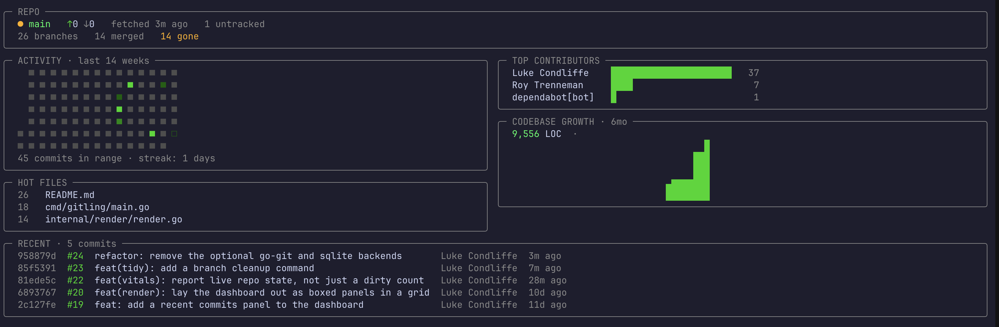
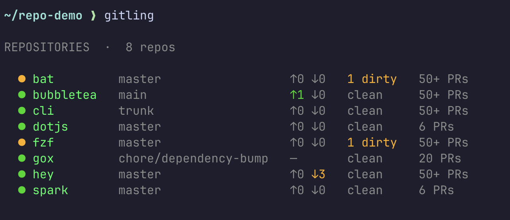

# gitling

[](https://github.com/lcondliffe/gitling/actions/workflows/ci.yml)

A terminal-native, at-a-glance summary of a git repository: recent activity,
top contributors, and codebase growth. Run it once at the start of a session to
orient yourself — it's not a replacement for `git log` or a full TUI.



Six panels on one screen. They lay out in two columns on a terminal at least
100 columns wide and stack into one below that; `--layout wide|stack` forces
either shape.

`--layout compact` (or `"layout": "compact"` in config) prioritizes current
state in short terminals and tmux panes. Auto switches to compact when the full
dashboard exceeds the detected height; explicit `wide` and `stack` always keep
their full layouts.

Compact targets at most 24 rows, or the terminal height if smaller, including
the surrounding blank lines. Panels use the full width:

- Repo state is mandatory: its minimum is two borders plus **all** wrapped
  state lines, including conflicts, interrupted operations, staged/modified
  work, upstream divergence, stash and branch-health warnings. Long branch
  names wrap rather than displacing warnings.
- Optional panels are admitted in order: open PRs, activity summary, recent
  commits, contributors, net-line history, hot files. Each needs two borders
  plus its complete body; the activity chart becomes an explicitly labelled
  summary. Once a panel cannot fit, it and the lower-priority panels are named
  in an `omitted:` footer. Existing title/path ellipses still mark width cuts.
- If even state plus the omission footer cannot fit, output deliberately
  exceeds the height and says so. Scroll rather than lose a blocker. Use
  `--layout stack` for full details; this is still one-shot output, not a TUI.

Rows are detected with an ioctl on Linux/macOS/BSD or the visible console
window on Windows. A positive `LINES` overrides rows **only on a real
terminal**. Unknown rows disable automatic compaction; pipes never inherit a
height limit. Explicit compact has a stable 24-row target and an 80-column
fallback when width is unknown. The existing `COLUMNS` width override remains
available, including in pipes. JSON is unaffected by layout or dimensions.

## Install

```sh
brew install lcondliffe/tap/gitling
```

Or with Go:

```sh
go install github.com/lcondliffe/gitling/cmd/gitling@latest
```

That writes to `$GOBIN`, or `$(go env GOPATH)/bin` when `GOBIN` is unset — make
sure it's on your `PATH`. Prebuilt binaries are on the
[latest release](https://github.com/lcondliffe/gitling/releases/latest).

## Usage

```sh
gitling                  # default dashboard (last 14 weeks)
gitling --since 30d      # activity, contributors and churn window (d, w, mo, y)
gitling graph --since 1y # focused activity drill-down
gitling churn --since 1y # file churn: all files, ranked by commit count
gitling contributors     # all authors, ranked (--since sets the window)
gitling branches         # branch overview: ahead/behind, last commit, author
gitling compare          # what this branch changes vs the default branch
gitling compare --base v1.2.0   # ... or vs any revision
gitling tidy             # dry run: local branches that are safe to delete
gitling tidy --apply     # actually delete them (prompts once)
gitling --recent 10      # list the last 10 commits (0 hides the panel)
gitling --layout stack   # force one column; --layout wide forces two
gitling --layout compact # prioritize current state in short panes
gitling --prs=false      # skip the open pull requests panel
gitling --json           # structured data for scripts/integrations (any view)
gitling --path services/api --exclude '*.lock'  # scope history to part of a monorepo
gitling --exclude-author 'renovate[bot]'        # leave an automation account out
gitling --date commit    # bucket by commit date instead of author date
gitling --color=always   # always, never, or auto (default; honors NO_COLOR)
gitling --config ~/gitling.json  # use an explicit config file
gitling                  # in a directory of repos: one-line-per-repo overview
gitling --fetch          # ...fetching each repo first for fresh ahead/behind
gitling --sort attention --worktrees  # ...what needs you first, worktrees included
```

Each drill-down is available as a subcommand or the matching `--flag`; naming
two different views is an error.

### Dates, scales and history scope

`--since` selects inclusive local calendar days for activity, contributors and
file churn, from today minus the duration through today. `mo` means 30 days and
`y` means 365 days here. These metrics cover non-merge commits reachable from
HEAD, using author dates by default (`--date commit` selects committer dates).
They do not count every branch. Recent commits ignore `--since`, include merges
and use committer dates. Repo/branch state, open PRs, the multi-repo overview
and `tidy` are live-state views, not filtered history.

`--path` and `--exclude` (both repeatable) are git pathspecs from the repo
root, so `--exclude '*.lock'` matches lockfiles at any depth. `--exclude-author`
drops commits whose (mailmap-resolved) author name or email matches exactly,
ignoring case; bots are never guessed. The scope applies to activity,
contributors, churn and growth before anything is counted, so all of them
agree. It does not apply to recent commits or live state. A scoped run prints
its scope (and adds its filters to the `--json` `scope` object) and skips the
history cache.

The heatmap prints the requested date interval, with year context, and a
compact intensity ramp (zero through the requested interval's daily peak;
nonzero levels are quartiles of that peak, not percentiles). `□` marks today;
rows run Sunday through Saturday. Narrow displays retain the newest weeks and
explicitly report the visible interval/count separately from requested totals
and streak, with an older-weeks omission marker. Long graph series sum adjacent
day/week/month buckets into width-bounded display bars; the scale is commits
per **display bar**, and the whole requested interval is retained. The counts
below remain the original nonzero calendar buckets; first/last buckets may be
partial because the requested window cuts through them.

Net-line history is **approximate historical net-line change**, not a count of
lines currently in the checkout. It cumulatively sums insertions minus deletions
from available HEAD non-merge history (negative cumulative samples clamp to
zero). Binary changes and merge-resolution changes are not represented; copied,
reverted or parallel changes can make this diverge from current LOC. Its chart
always samples the last **six calendar months**, independently of `--since`,
using `--date`'s basis. The chart labels its date window and min/max scale;
percentage compares the cumulative total with the six-month baseline, when
available. Narrow growth charts retain bucket endpoints, not sums of cumulative
samples. Shallow clones get an explicit incomplete-history caveat. The existing
JSON `growth.total_loc` field retains its compatibility name and the same
approximate semantics.

## JSON output

`--json` works with every view: the dashboard, `graph`, `churn`,
`contributors`, `branches`, `compare`, and the multi-repo overview. Stdout is
exactly one JSON document; warnings and errors go to stderr. Every document
starts with:

- `schema_version`: `1`. New keys may be added without a bump; removing or
  changing a key bumps it.
- `view`: `dashboard`, `graph`, `churn`, `contributors`, `branches`,
  `compare`, or `workspace` (the multi-repo overview).
- `generated_at`: RFC 3339 timestamp.
- `repository`: `{name, remote}`. `name` is the repository's directory name,
  the same from any of its worktrees. `remote` is origin's host and path
  only (no user, credentials or query), or `null` when there is no origin or
  it isn't a recognisable network remote (a local path, say).
  `repository` itself is `null` for `workspace`.

History views (`dashboard`, `graph`, `churn`, `contributors`) add
`scope: {range, date_basis}`, plus `paths`, `exclude_paths` and
`exclude_authors` when `--path`, `--exclude` or `--exclude-author` (or config)
filter history. The dashboard keeps its original keys, including `range`.

Lists are complete unless noted. The dashboard's panels stay capped as on
screen (use the drill-downs for full lists); `compare` lists every changed
file but at most 10 commits, with `commit_count` and `commits_truncated`
describing the rest; `workspace` reports rows `--only attention` left out as
`hidden`.

`null` means the value doesn't exist or can't be known (no upstream, never
fetched, ahead/behind with nothing to compare against, line counts of a binary
file, a `workspace` checkout's `status` when it couldn't be probed, with the
reason in `error`). An empty array means there was nothing to list. Open PRs
are only the real answer when `forge.status` is `ok`: the dashboard and each
`workspace` checkout carry `forge: {cli, status, truncated, checked_at}`
(`null` when the lookup was off). In `workspace`, `open_prs` is a count and
`open_prs_capped` mirrors `forge.truncated`.

Branches report `checked_out` rather than the worktree path, and `workspace`
names checkouts as the table does: relative to the current directory or `~`,
and absolute only for a `--worktrees` checkout outside both.

## Open PRs

The dashboard shows a panel of open pull requests for GitHub and GitLab
remotes. It never talks to a forge API itself: it shells out to the platform's
own CLI ([`gh`](https://cli.github.com) or
[`glab`](https://gitlab.com/gitlab-org/cli)), so authentication is whatever
that CLI already has. The panel says "none open" when there are none, and names
the reason when it couldn't ask: CLI not installed, not logged in, timed out,
or query failed. A capped list says it is truncated. A remote gitling doesn't
recognise shows no panel, and `--prs=false` skips the lookup altogether. In
`--json`, `forge` carries the CLI, `status`, `truncated` and `checked_at`
behind `open_prs`.

GitLab remotes show merge requests as `Open MRs` with `!123` numbers, and
`glab` is always given the project explicitly (from `origin`), so nested
groups, SSH remotes and checkouts with several remotes need no extra setup;
tidy's forge verification asks the same host and project.
github.com and gitlab.com are recognised out of the box; map a self-managed
host to its forge with `forge_hosts` in the config file:

```json
{ "forge_hosts": { "gitlab.example.com": "gitlab" } }
```

`glab` must already be logged in to that host (`glab auth login --hostname
gitlab.example.com`). It needs a recent `glab` with `mr list --output json`
(tested with 1.126; distro builds such as 1.36 lack it).

## Many repos



Run `gitling` in a directory that isn't a repo but whose immediate
subdirectories are (a `~/repo/*` layout) and it renders a one-line-per-repo
overview instead of an error: current branch, ahead/behind upstream,
working-tree state, and the open PR count. Ahead/behind comes from the local
tracking refs — instant, but only as fresh as each repo's last fetch;
`--fetch` fetches every repo first (failures fall back to local refs). PR
counts follow the same rules as the dashboard panel and are skipped with
`--prs=false`. Only immediate children are scanned, and nothing is written.
Each row also shows an interrupted operation (rebase, merge, bisect, ...) and
how long ago the repo last fetched.

`--sort attention` puts the checkouts that need you first, in this order:
conflicts, an interrupted operation, uncommitted changes, unpushed commits,
then a failed `--fetch`, a fetch more than a week old, or a checkout that
couldn't be read. Ties keep alphabetical order. `--only attention` hides the
rest. `--worktrees` adds each repo's linked worktrees, wherever they live;
a checkout found twice is listed once, and the fetch and PR lookup run once per
repository. Checkouts that can't be read stay in the list with the reason, and
the full error goes to stderr.

## Tidy

`gitling tidy` is the one subcommand that changes anything. It finds the local
branches you're done with and, on request, deletes them:

```sh
gitling tidy                  # dry run over merged + forge-verified squash merges
gitling tidy --apply          # delete them, prompting once first
gitling tidy --merged         # narrow to branches merged into the default branch
gitling tidy --gone           # narrow to upstream-gone branches, verified or not
gitling tidy --stale          # also include branches untouched for 90 days
gitling tidy --stale 180d     # ...with a different threshold
gitling tidy --protect 'release/*'   # never delete matching branches
gitling tidy --apply --yes    # no prompt, for when you already know
gitling tidy --no-fetch       # skip the pruning fetch
```

```text
TIDY  ·  4 of 9 branches

  merged into origin/main   -d
    chore/tidy-readme   14d ago    a1b2c3d

  squash-merged, verified on the forge   -D
    feat/heatmap        1mo ago    9f8e7d6
    fix/parse-numstat   3mo ago    4c5b6a7

  4 branches to delete, 3 needing -D
  dry run — pass --apply to delete
```

### What it selects, and how much it trusts each category

Which group a branch lands in decides how it gets deleted:

- **merged** — the tip is an ancestor of the default branch, so the work is
  provably in. Deleted with `git branch -d`, leaving git's own merge check as a
  second safety net under gitling's.
- **verified** — the upstream is gone and the forge (read-only, via `gh` or
  `glab`) has a pull request from this repo, at exactly the local tip, merged
  into the default branch, whose merge or squash commit is still in it. The
  commits landed under new hashes, so git sees the branch as unmerged and only
  `-D` will drop it.
- **gone, closed, could not verify** — the upstream is gone but the forge has no
  PR at this tip (deleted unmerged, pushed to after merging, a reused name, a
  fork), the PR was closed unmerged, or the forge couldn't be asked or its
  answer didn't check out. These are listed as kept and only selected with
  `--gone`.
- **stale** — old, and neither merged nor gone. The only category where deleting
  can lose work, so it's never selected unless you ask with `--stale`.

`--merged` and `--gone` narrow the selection to what they name. `--stale` only
ever adds: asking to also clean up the old ones shouldn't quietly stop cleaning
up the safe ones.

"Merged" is measured against the *remote* default branch, so a branch merged
into your local `main` but never pushed is treated as unmerged and needs `-D`.

### Safety

- **Dry run by default.** Nothing is deleted without `--apply`, which prompts
  once (unless `--yes`) with the full plan on screen. Anything that isn't an
  explicit `y` — a bare newline, no stdin at all — is a no.
- **The current and default branches are never deleted**, nor anything matching
  a `--protect` glob or the config file's `protect` list. `--protect` adds to
  that list rather than replacing it.
- **Every branch shows the commit it pointed at**, before and after deletion, so
  anything can be restored with `git branch <name> <hash>`.
- **It fetches with `--prune` first** (skip with `--no-fetch`), because
  "upstream gone" is meaningless against stale remote-tracking refs. A failed
  fetch warns and continues — being offline shouldn't stop you tidying merged
  branches — but it says so, because the plan is then built on older
  information.
- **Each tip is rechecked just before deletion**; a branch that moved since the
  plan was made is kept.
- A branch git refuses to delete is reported and the rest still run.

## Config file

gitling optionally reads defaults from
`$XDG_CONFIG_HOME/gitling/config.json`, falling back to
`~/.config/gitling/config.json`. Override with `--config <path>` or
`GITLING_CONFIG`. A missing file is fine; a malformed one is reported to
stderr.

```json
{
  "since": "30d",
  "color": "auto",
  "bucket": "week",
  "recent": 5,
  "layout": "auto",
  "prs": true,
  "protect": ["release/*", "wip/keep-me"],
  "exclude": ["*.lock", "*package-lock.json"],
  "exclude_authors": ["dependabot[bot]"],
  "forge_hosts": { "gitlab.example.com": "gitlab" }
}
```

Command-line flags override the config file, which overrides the built-in
defaults. `protect`, `exclude` and `exclude_authors` are the exception: their
flags add to the configured list rather than replacing it, since a config
saying "never delete `release/*`" shouldn't be switched off by naming one more
pattern.

## Build

```sh
go build ./cmd/gitling
```

Pure Go standard library: `go.mod` has no requirements and there is no
`go.sum`. Needs `git` on `PATH` at runtime.
